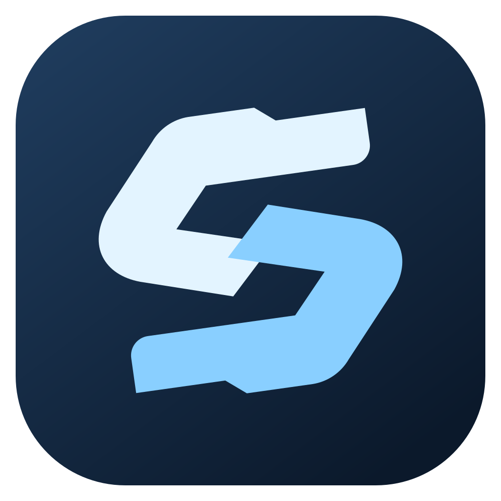

# Sekvona

A browser workspace for every project.

The Sekvona mark combines two tab silhouettes into a tilted S on a navy tile. Edit the vector in `mark.svg` to update the icon.

Run `yarn brand:apply` to regenerate metadata and native icons. Display copy lives beside the components that use it. No domain or trademark ownership is asserted.

## Design sources

Native macOS ICNS and PNG sizes from 16 to 1024 pixels are generated from `mark.svg`. The bundled renderer SVG and application PNGs use the same source.

## Compatibility

The display name is Sekvona. The production bundle ID stays `com.multizen.desktop`. Existing profiles, settings, and credentials continue to use the `MultiZen` data directory and Safe Storage namespace. Electron receives the legacy name before ready, then the display name after ready. An explicit `--user-data-dir` selects an isolated test directory.

Internal `@multizen/*` package names, IPC channels, cloud object paths, archive extensions and managed agent configuration markers remain stable. These are persistence contracts, not user-facing branding. Cloud Sync, MCP gateway, OAuth and credential backups remain part of the fork and regression suite.

The GitHub repository and update channel use `irensaltali/sekvona`. Release collection emits canonical Sekvona artifacts plus byte-identical `MultiZen-mac-{arm64,x64}.dmg` aliases so 0.4.3 Mac clients retain a working upgrade link. Apple Developer ID signing and notarization are a separate release task; rebranding does not solve Gatekeeper warnings.

## Taking upstream improvements

Never reset the fork to upstream or blanket-select one side of a merge.

1. Commit local work. From the updated development branch run `yarn upstream:prepare ../sekvona-upstream-review`.
2. The script fetches original `master` without importing upstream tags, then merges in a separate Git worktree and `feature/upstream-*` branch. Your current branch is untouched.
3. Conflicts and any changes to paths in `upstream-policy.json` stop for manual review. Resolve in the review worktree, retaining our behavior while adapting shared upstream code. A stopped review intentionally remains on disk.
4. In that worktree run `yarn install --immutable`, `yarn brand:apply`, `yarn brand:check`, `yarn test:fork`, `yarn typecheck`, `yarn test`, and `yarn workspace @multizen/desktop exec electron-vite build`.
5. Review the diff, commit the merge and push the review branch. Merge it into development after review, then promote development to main through a separate PR. Publish via the existing version/tag workflow when ready.

The weekly/manual `Prepare upstream review` GitHub workflow performs the same process and pushes a branch only after all checks pass. It never pushes main, force-pushes, merges a PR or publishes. It becomes scheduled after this workflow reaches the default branch. An existing review branch is not overwritten; finish or remove the previous review before retrying the same upstream revision.

`Fork compatibility` runs on PRs and fork branches. Checks cover identity, legacy storage, updater ownership, Sync refresh wiring, legacy managed markers and the existing feature suites. Tests cannot prove every semantic change safe: review shared code before merging. Repository administrators can still bypass ordinary CI; branch protection is not configured by these files.

## Validation

`yarn test:fork` exercises real temporary Git repositories, including clean merges, custom-feature deletions, conflicts, dirty worktrees and already-integrated upstream. Release tests validate both architectures, hashes and the legacy Mac download alias. `yarn test` exercises the existing Sync, gateway, OAuth, credentials, profiles, settings, renderer and Kopia behavior.

Original MultiZen attribution and MIT notices remain in the repository.
